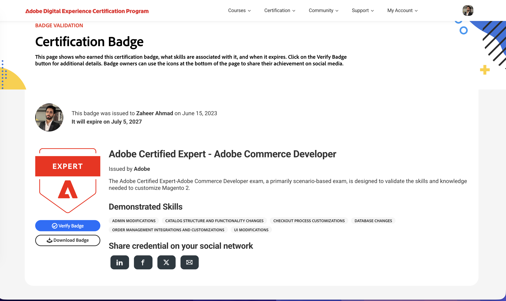
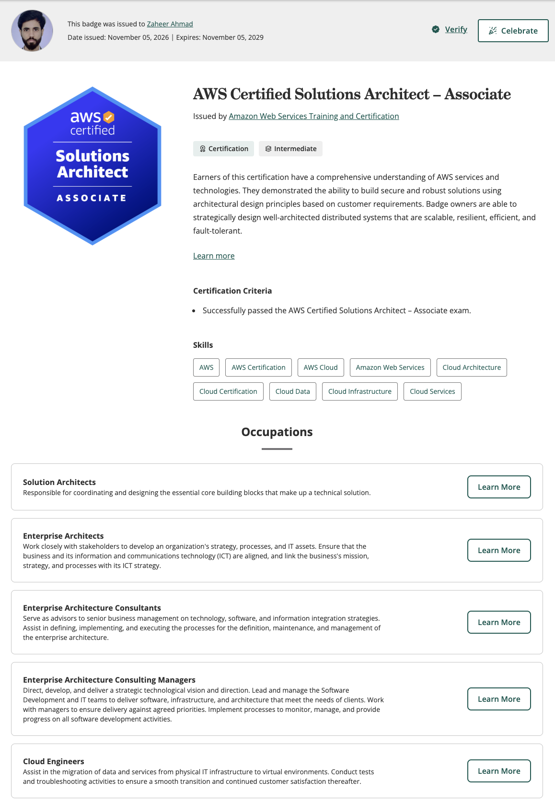

<h1 align="center">Hi, I'm Zaheer Ahmed 👋</h1>

<h3 align="center">
  Software Solutions Architect | Cloud & E-commerce Architect
</h3>

  
  
  

---

## 👨‍💻 About Me

I'm a **Software Solutions Architect** with 10+ years of experience designing, developing, and delivering scalable enterprise software solutions.

My expertise spans enterprise digital commerce, cloud architecture, system integration, and application engineering.

I've worked with international retail brands and enterprise platforms, designing solutions for high-traffic e-commerce environments, complex integrations, and business-critical operations.

I combine hands-on engineering experience with architectural thinking to transform business requirements into scalable, reliable, and maintainable technology solutions.

- 🏗️ Enterprise Solution Architecture & System Design
- ☁️ AWS Cloud Architecture & Infrastructure
- 🛒 Adobe Commerce (Magento 2) & Shopify Ecosystems
- 🔗 API Design, Microservices & System Integration
- ⚡ Performance Optimization & High Availability
- 🚀 Digital Transformation & Technical Leadership
- 🤖 AI-powered Applications & Automation

---

## 🏆 Professional Certifications

  

  

  

### Verified Certification Credentials

  

  

---

## 🛠️ Technology Stack

### Cloud & Infrastructure

  

### E-commerce & Platforms

  

### Programming & Development

  

### Databases & Tools

  

**Additional expertise:**

Adobe Commerce, Magento 2, Shopify Plus, REST APIs, GraphQL, Microservices, Couchbase, AWS architecture, system integration, performance engineering, and enterprise application design.

---

## 💼 Areas of Expertise

| Domain | Expertise |
|---|---|
| Solution Architecture | Enterprise Architecture, HLD, LLD, Design Patterns |
| Cloud Architecture | AWS, High Availability, Scalability, Disaster Recovery |
| Digital Commerce | Adobe Commerce, Magento 2, Shopify Plus |
| Backend Engineering | PHP, Node.js, Custom APIs, Microservices |
| Integration | REST, GraphQL, ERP & Third-party Integrations |
| Infrastructure | Docker, NGINX, Linux, Cloudflare |
| Data & Performance | Database Optimization, Indexing, Caching |
| Technical Leadership | Architecture Reviews, Engineering Strategy, Delivery |

---

## 🚀 Projects & Innovation

I enjoy building practical software products and exploring technologies beyond enterprise projects.

My areas of interest include:

- 🤖 AI-powered SaaS applications
- 🛍️ Shopify public applications and e-commerce automation
- 🖼️ Image processing and optimization solutions
- 🔗 Enterprise integrations and automation tools
- ☁️ Cloud-native applications and scalable infrastructure

I believe in building products that solve real business problems.

---

## 📊 GitHub Statistics

  
  

  

---

## 🤝 Let's Connect

I'm always interested in discussing software architecture, cloud technologies, digital commerce, AI applications, and innovative engineering solutions.

**Open to opportunities:**

- Solutions Architect
- Principal Solutions Architect
- Cloud Solutions Architect
- Technical Architect
- Technical Leadership

  
  

  <i>Building scalable solutions. Solving complex problems. Creating impact through technology.</i>

