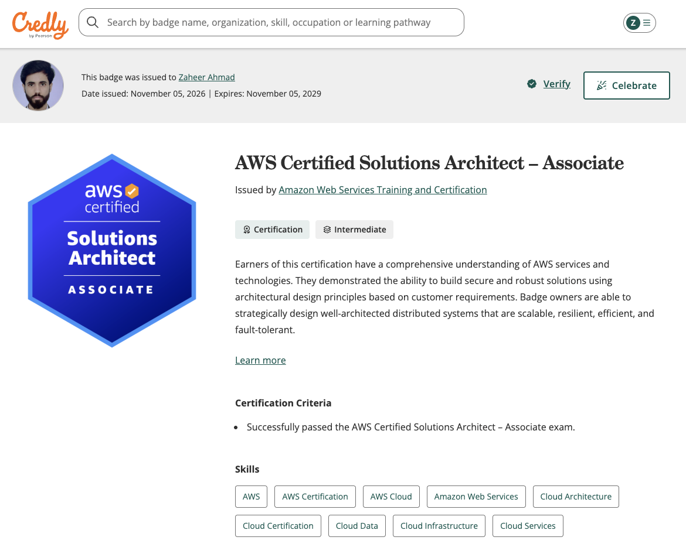
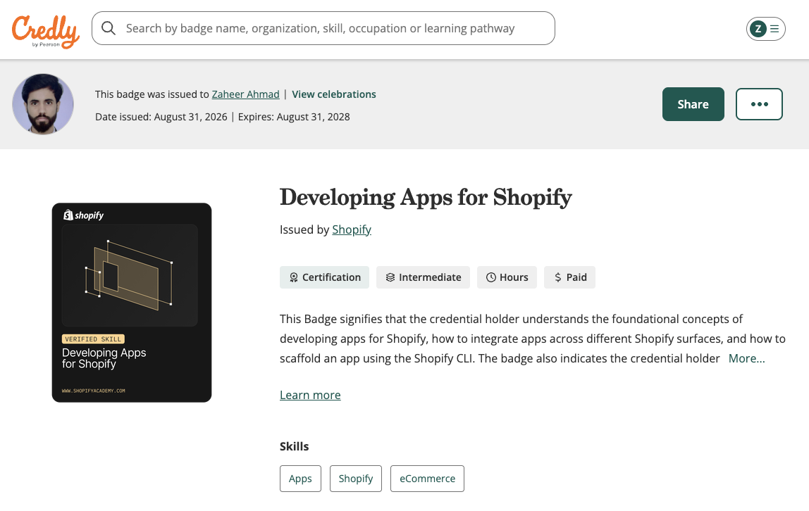
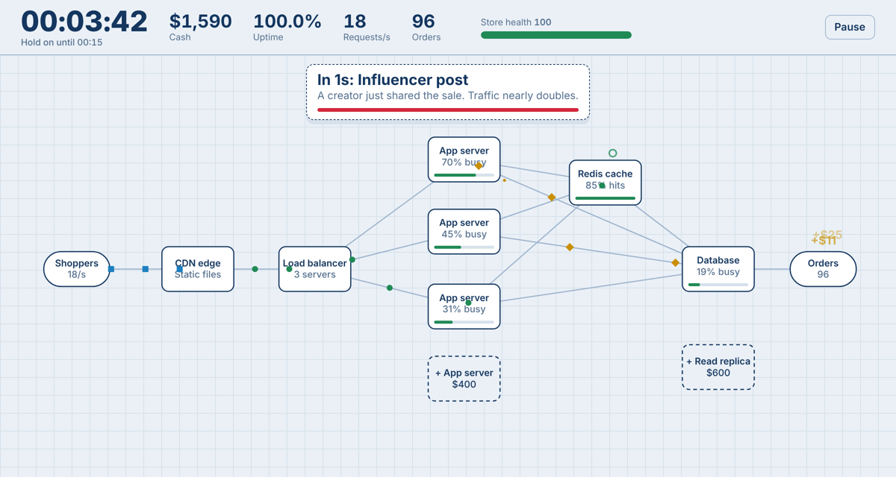

<h1>Zaheer Ahmad</h1>

<h3>Software Solutions Architect | Cloud & E-commerce Architect</h3>

  10+ years designing, modernizing, and leading enterprise software platforms across 
  digital commerce, AWS cloud architecture, and system integration.

  
  
  

  AWS Certified Solutions Architect – Associate&nbsp;&nbsp;·&nbsp;&nbsp;Adobe Certified Expert – Adobe Commerce Developer&nbsp;&nbsp;·&nbsp;&nbsp;Developing Apps for Shopify

  <a href="#about">About</a>&nbsp;&nbsp;·&nbsp;&nbsp;
  <a href="#certifications">Certifications</a>&nbsp;&nbsp;·&nbsp;&nbsp;
  <a href="#shopify-apps--development">Shopify Apps</a>&nbsp;&nbsp;·&nbsp;&nbsp;
  <a href="#architecture--engineering-portfolio">Architecture</a>&nbsp;&nbsp;·&nbsp;&nbsp;
  <a href="#technical-skills">Skills</a>&nbsp;&nbsp;·&nbsp;&nbsp;
  <a href="#game:-black-friday-rush">Game</a>&nbsp;&nbsp;·&nbsp;&nbsp;
  <a href="#lets-connect">Contact</a>

---

## About

I'm a **Software Solutions Architect** based in Bangkok, Thailand, with 10+ years of experience across software engineering, enterprise architecture, digital commerce, cloud solutions, and technical leadership.

I turn business requirements into scalable, reliable, and maintainable platforms — owning architecture end to end, from system design and integration strategy through production readiness, performance, and incident resolution. My background as a hands-on backend engineer and team lead keeps my architecture grounded in what teams can actually build and operate.

| Area | Focus |
|---|---|
| **Architecture** | Enterprise software architecture, microservices, system integrations, REST and GraphQL APIs |
| **Digital Commerce** | Adobe Commerce / Magento 2, Shopify and Shopify Plus, enterprise, multi-brand, and multi-country commerce |
| **Cloud** | AWS cloud architecture, high availability, scalability, and disaster recovery |
| **Performance & Data** | Performance optimization, database architecture, caching, and background processing |
| **Leadership** | Technical leadership, architecture reviews, mentoring, and digital transformation |

### Career Highlights

- **Enterprise fashion retail:** led solution architecture for **H&M and COS** e-commerce environments across Southeast Asia, spanning Adobe Commerce Cloud, Shopify Plus, AWS, PIM, payments, search, and marketplace integrations.
- **Peak-traffic resilience:** designed traffic-protection and product-ranking capabilities to keep commerce platforms available during the highest-demand sales events.
- **Multi-tenant scale:** architected a custom Magento indexing approach supporting **800 storefronts** on a single shared platform for a US-based SaaS client.
- **Modernization:** led an enterprise search migration from Elasticsearch to Algolia for a major electronics retailer.
- **Delivery:** led a 14-person cross-functional engineering team and used blue/green deployment strategies for zero-downtime production releases.

---

## Certifications

<table>
  <tr>
    <td width="230" align="center">
      
    </td>
    <td>
      <b>AWS Certified Solutions Architect – Associate (SAA-C03)</b> 
      Amazon Web Services · Valid through Nov 2029 
      <a href="https://www.credly.com/badges/ec062ced-71d7-4620-a83b-efe019a9d522">Verify on Credly →</a>
    </td>
  </tr>
  <tr>
    <td width="230" align="center">
      
    </td>
    <td>
      <b>Adobe Certified Expert – Adobe Commerce Developer</b> 
      Adobe · Valid through Jul 2027 
      <a href="https://certification.adobe.com/credential/verify/e3529bf6-54ba-4239-84ae-c761517b25da/linkedin">Verify on Adobe →</a>&nbsp;&nbsp;·&nbsp;&nbsp;<a href="https://www.credly.com/badges/1fa532e5-4e1e-42e2-9fa4-26624dbd58d1">Credly record</a>
    </td>
  </tr>
  <tr>
    <td width="230" align="center">
      
    </td>
    <td>
      <b>Developing Apps for Shopify</b> 
      Shopify · Verified Skills Badge · Valid through Aug 2028 
      <a href="https://www.credly.com/badges/4019cf5f-d69a-4a55-bc1a-f5419fd28662">Verify on Credly →</a>
    </td>
  </tr>
</table>

---

## Shopify Apps & Development

Published apps on the Shopify App Store that I've designed and built, covering store monitoring, image SEO, and automated pricing.

<table>
  <tr>
    <td width="84" align="center">
      
    </td>
    <td>
      <a href="https://apps.shopify.com/altstar"><b>AltStar</b></a>&nbsp;&nbsp;SEO · Accessibility 
      Finds product images with missing ALT text and generates it in bulk from a store-defined template, with real-time product sync and daily scheduled generation on higher plans.
    </td>
  </tr>
  <tr>
    <td width="84" align="center">
      
    </td>
    <td>
      <a href="https://apps.shopify.com/flashsale-dog"><b>Flash Sale</b></a>&nbsp;&nbsp;Pricing · Bulk Editor 
      Schedules flash-sale campaigns: prices update through the Shopify Admin API when a sale starts, a public page shows a live countdown, and original prices are restored automatically when it ends. Supports bulk SKU import.
    </td>
  </tr>
  <tr>
    <td width="84" align="center">
      
    </td>
    <td>
      <a href="https://apps.shopify.com/storeguard-5"><b>StoreGuard – Store Monitor</b></a>&nbsp;&nbsp;Store Monitoring 
      Monitors product, variant, inventory, price, collection, media, and publishing changes; flags unusual catalog activity as prioritized incidents, with change history, automated scans, and alerts.
    </td>
  </tr>
</table>

---

## Architecture & Engineering Portfolio

| Capability | In practice |
|---|---|
| **Enterprise E-commerce Architecture** | Multi-brand, multi-country Adobe Commerce Cloud and Shopify Plus platforms integrated with PIM, payments, search, translation, and marketplace services |
| **AWS Solutions Architecture** | Serverless and cloud-native integrations using Lambda, API Gateway, EC2, S3, CloudFront, and Route 53 |
| **Shopify App Architecture** | Three published apps built on the Shopify Admin API, with scheduled background jobs and bulk catalog operations |
| **API-First Architecture** | REST and GraphQL APIs and middleware connecting commerce with payment gateways, logistics, OMS, and ERP systems |
| **Microservices** | Independent integration services and middleware decoupling commerce platforms from back-office systems |
| **Multi-Tenant Platforms** | An 800-storefront shared Magento platform, and Shopify apps serving many merchants from one codebase |
| **Cloud Infrastructure** | Docker, Kubernetes, NGINX, CDN edge logic (Fastly, Cloudflare), CI/CD, and blue/green releases |
| **Application Modernization** | Search re-platforming (Elasticsearch to Algolia), commerce performance optimization, and serverless integration patterns |

### Selected Public Repositories

| Repository | Description | Stack |
|---|---|---|
| [adobe-commerce-waiting-room](https://github.com/zaheercena/adobe-commerce-waiting-room) | Documented waiting-room solution for Adobe Commerce Cloud: Fastly VCL routes overflow traffic to a holding page, with an AWS Lambda and API Gateway admission API and ElastiCache Redis session state. Includes architecture diagrams, deployment checklist, and troubleshooting guide. | Fastly VCL · AWS Lambda · API Gateway · Redis · Node.js |
| [wishlist-api-magento](https://github.com/zaheercena/wishlist-api-magento) | Custom Magento 2 REST endpoints to add, remove, and list customer wishlist items. | PHP · Magento 2 · REST |
| [zaos](https://github.com/zaheercena/zaos) | Academic operating-system kernel: interrupts, multitasking, system calls, disk I/O, and heap allocation. | C++ · C |
| [D_OS](https://github.com/zaheercena/D_OS) | Minimal bootable kernel written in D (practice project). | D |

---

## Technical Skills

  

| Category | Skills |
|---|---|
| **E-commerce & Platforms** | Adobe Commerce, Magento 2, Shopify, Shopify Plus, Shopify App Development, Multi-Store and Multi-Brand Commerce, Headless Commerce |
| **Programming Languages** | PHP, Python, Go (Golang), D, JavaScript, TypeScript, HTML, CSS |
| **Frameworks & Runtime** | Node.js, React, Remix, Magento 2 framework |
| **Cloud & Infrastructure** | AWS (EC2, S3, RDS, CloudFront, Route 53, IAM, VPC, Lambda, API Gateway, ElastiCache), Docker, Kubernetes, Linux, NGINX, Cloudflare, Fastly |
| **Databases** | MySQL, PostgreSQL, MongoDB, Couchbase, Redis |
| **Search & Enterprise Integration** | Elasticsearch, OpenSearch, Algolia, MuleSoft, Akeneo PIM |
| **Architecture & Integration** | REST APIs, GraphQL, Microservices, API Integration, Event-Driven Architecture, Distributed Systems, Multi-Tenant Architecture, High Availability, Disaster Recovery |
| **Tools & IDEs** | GoLand, PhpStorm, Visual Studio Code, Git, GitHub, Docker, Postman, Jenkins |

---

## GitHub Statistics

  
  

Generated as local SVG files by a GitHub Actions workflow in this repository.

---

## Game: Black Friday Rush

Keep an online store running through a midnight sale by building a CDN, cache, load balancer and servers. A 3-minute game inspired by peak-traffic architecture. **[Play now](https://zaheercena.github.io/)**

---

## Let's Connect

I'm interested in conversations about software architecture, cloud platforms, and enterprise digital commerce.

**Open to:** Solutions Architect · Principal Solutions Architect · Cloud Solutions Architect · Software Architect · Technical Architect · Enterprise Architect · Technical Lead · Software Engineering Manager

  
  
  

