# Zaheer Ahmad

**Software Solutions Architect | Backend & Platform Engineering**

I design and operate commerce platforms, with 10+ years across backend engineering, AWS architecture, and production reliability. I’m based in Bangkok, Thailand (UTC+7), and open to solutions architecture, senior systems engineering, and backend or platform engineering roles, including international remote opportunities.

[LinkedIn](https://www.linkedin.com/in/zaheercena/) · [Email](mailto:zaheercena@gmail.com)

## Featured work

- **H&M Black Friday Virtual Waiting Room.** Designed a waiting room to queue overflow traffic and control storefront admission during peak sales. The public reference design covers Fastly VCL edge routing, a Node.js admission service on AWS Lambda behind API Gateway, and ElastiCache Redis for session state. [View the reference design](https://github.com/zaheercena/adobe-commerce-waiting-room)
- **Catalog indexing for 800 storefronts.** Designed custom Magento indexing for a U.S. SaaS client whose storefronts ran on a shared multi-tenant platform.
- **Production reliability.** Resolved a catalog indexer overflow in MariaDB Galera by migrating its version counter to `BIGINT`. Used blue/green deployments to deliver production releases without downtime.
- **Search migration.** Led the move from Elasticsearch to Algolia for a major electronics retailer and optimized Magento catalog indexing.

## Live Shopify apps

I designed and built these apps and published them through UFURT LLC.

- **StoreGuard.** Monitors catalog, inventory, pricing, and publishing changes. Flags unusual activity and gives merchants alerts and a change history. [StoreGuard on Shopify](https://apps.shopify.com/storeguard-5)
- **Flash Sale.** Schedules campaigns and applies bulk price changes through the Shopify Admin API. Restores original prices automatically when a sale ends. [Flash Sale on Shopify](https://apps.shopify.com/flashsale-dog)
- **AltStar.** Finds missing product image alt text and fills it in using merchant-defined templates, product sync, and scheduled bulk processing. [AltStar on Shopify](https://apps.shopify.com/altstar)

## Public code samples

- **Magento Wishlist API.** PHP REST endpoints to list, add, and remove wishlist items in Magento 2. [View the code](https://github.com/zaheercena/wishlist-api-magento)
- **zaos.** An academic C/C++ operating system kernel with interrupts, multitasking, system calls, disk I/O, and heap allocation. [View the source](https://github.com/zaheercena/zaos)

## Technical stack

- **Backend and integrations** · PHP, TypeScript, Node.js, Python, REST, GraphQL, MuleSoft
- **Cloud and delivery** · AWS Lambda, API Gateway, EC2, S3, CloudFront, ElastiCache, Linux, NGINX, Docker, Kubernetes, Fastly, GitHub Actions, Jenkins
- **Data and messaging** · MariaDB Galera, MySQL, PostgreSQL, Redis, Valkey, RabbitMQ, Elasticsearch, OpenSearch, Algolia
- **Commerce** · Adobe Commerce Cloud, Magento 2, Shopify Plus, Shopify Admin API, Akeneo PIM

## Certifications

- [AWS Certified Solutions Architect – Associate](https://www.credly.com/badges/ec062ced-71d7-4620-a83b-efe019a9d522)
- [Adobe Certified Expert – Adobe Commerce Developer](https://certification.adobe.com/credential/verify/e3529bf6-54ba-4239-84ae-c761517b25da/linkedin)
- [Developing Apps for Shopify · Verified Skills Badge](https://www.credly.com/badges/4019cf5f-d69a-4a55-bc1a-f5419fd28662)

## Interactive demo

**Black Friday Rush** is a short browser game about keeping an online store available through a traffic spike. [Play Black Friday Rush](https://zaheercena.github.io/)

GitHub activity and repository languages

